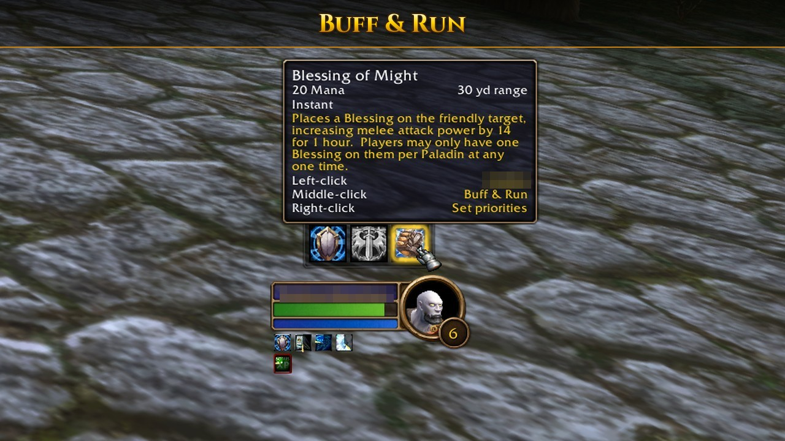
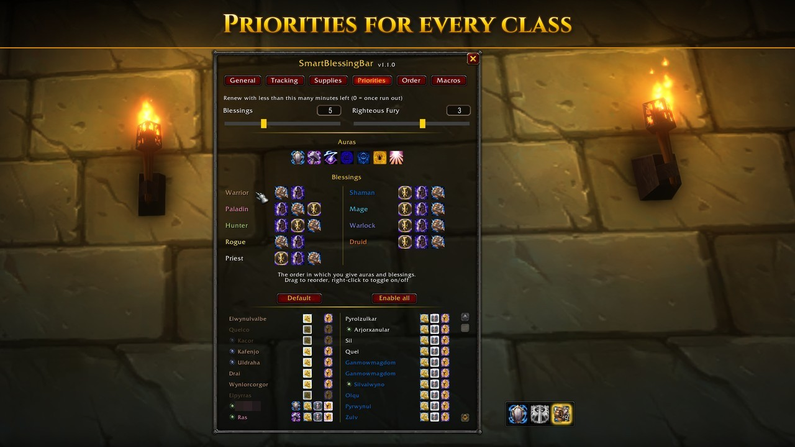
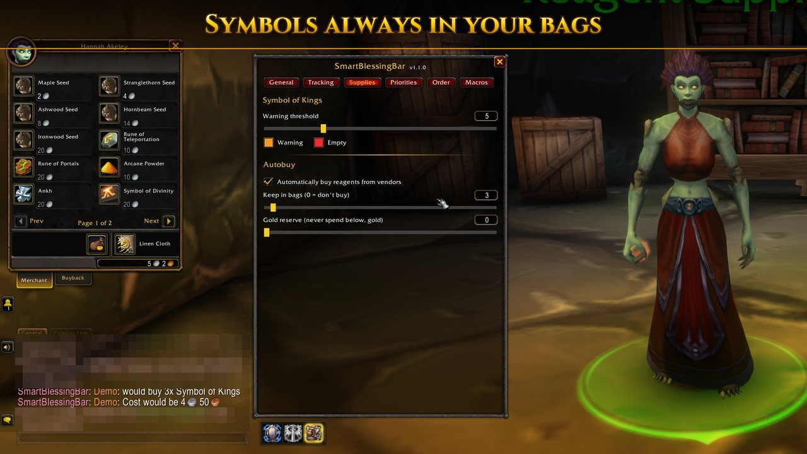

# SmartBlessingBar

**Auras and blessings for your whole group - on one slim bar.**
Built for **WoW Forever**. Loads for paladins only.

## 🆕 New in v1.1.0

- **Ready for launch:** Blizzard removed Salvation, Mass Salvation, Revoke and Blessing of Light
  shortly before launch. The addon hides them and shows them again by itself if the game brings
  them back.
- **A new bug report:** type `/sbb bug`, say what happened and paste one code into the form.
  It filters your character, realm, guild, current group, target and focus, GUIDs, BattleTags,
  e-mail addresses and file paths, and "Show content" shows everything it holds.
- **Stronger blessings reach everyone:** your own weaker blessing is renewed, after you learn a
  higher rank too.
- **Auras that move on:** when another paladin runs the same aura as you, your button offers the
  next one.
- **A highlight that tells the truth:** a button's glow goes out once its spell is cast in combat.
- **Clearer tooltips:** every tooltip lists the clicks left, middle, right, and says when everyone
  who still needs a blessing is out of range.
- **Buff & Run and PvP:** players flagged for PvP are blessed while you are flagged for good
  yourself.
- **Lighter on your game:** group members' buffs are read again only when the game reports a
  change, or after 10 s.
- **New settings:** Show anchor keeps the bar's handle visible, and Window background sets the
  settings and report windows from none to solid.

---

## 👑 Blessings that plan themselves

- **One button** casts the next blessing your group needs - Greater Blessings where they
  pay off, the best rank each player can take. A number shows how many are left.
- **Other paladins count:** what they already gave is skipped, so nobody blesses twice.
- **Renewed in time:** the button glows a few minutes before a blessing runs out.
- **Says why it waits:** with nothing to cast, the tooltip tells you - everyone in need is
  out of range, or the cast waits for the end of combat.
- **Buff & Run:** middle-click to bless the player you target and jump to the next one -
  perfect for blessing passers-by in town. It does not flag you for PvP unless you allow
  it: a flagged player is blessed only while you are flagged for good yourself, or with
  Allow PvP blessing on.
- **Light on your game:** your group's buffs are read again only when they change, or
  every 10 s at most.

## 🛡️ The right aura and Fury

- **Auras by priority:** your list decides, and an aura another paladin already runs is
  passed on to your next one.
- **Righteous Fury** when you tank.

## ⚖️ Your priorities, per class

Drag auras and blessings into the order you want for each class, switch any of them off.
The **group overview** shows at a glance who carries what.

## 📜 Symbols of Kings, always in your bags

A warning when they run low, and **auto-buy** at the vendor up to the amount you set -
never below your gold reserve.

## ✨ Make it yours

Horizontal or vertical, any button order, scale, colors, border, window background.
**11 languages**, switchable in game. **Demo mode** shows a full raid before you have one.
Key bindings for the next buff, Buff & Run and the priorities.

## 🕯️ Found a bug?

Type `/sbb bug`: the addon writes the report for you - it filters your character, realm, guild,
current group, target and focus; friends and guild members outside the group can remain - and
shows the code and the link to the form. What a report holds and how it is handled:
[Privacy and security](https://github.com/ZulshiBLN/SmartBlessingBar#privacy-and-security).

---

**Get started:** `/sbb` opens the settings · drag the handle at the bar's edge to move it ·
`/sbb help` lists all commands.

**Free and open source** (MIT) · no network traffic, no chat messages ·
[GitHub](https://github.com/ZulshiBLN/SmartBlessingBar) for source, issues and releases.
